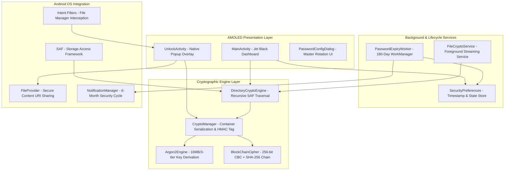

# Keeper LoLock - System Architecture Specification

## 1. Executive Summary

**Keeper LoLock** (Local Lock) is an ultra-secure, zero-database local file and directory encryption engine designed for Android 9 through Android 15 (API levels 28 to 35). It implements a cryptographic fusion of **Argon2id** memory-hard key derivation and **AES-256-CBC with SHA-256 block-chained integrity verification** (blockchain model), rendered across a pure Jet Black AMOLED interface (`#000000`) with metallic silver accents.

---

## 2. Layered Architecture Overview

The system is structured across four decoupled, high-performance layers:

---

## 3. Core Architectural Tenets

### 3.1 Zero-Database Paradigm
Conventional encryption vaults maintain an encrypted SQLite or Room database indexing locked files, tags, and cached keys. This creates a catastrophic single point of failure: an attacker extracting the database file can mount high-speed GPU or ASIC dictionary attacks against a single target. 

Keeper LoLock operates on a **Zero-Database architecture**:
1. Every encrypted file is a fully self-contained cryptographic container (`.lolock`).
2. Each file possesses an independently generated 16-byte cryptographically secure random salt and 16-byte IV.
3. No centralized catalog or index file exists anywhere on the device.
4. Cracking one container reveals zero mathematical advantage or key material for cracking any other container on the same device.

### 3.2 Constant Memory O(1) Streaming Buffer
To support encrypting and decrypting arbitrary file sizes (e.g. 4GB+ 4K video files, multi-gigabyte ZIP or TAR archives) without causing Android Out-Of-Memory (OOM) errors:
- Memory consumption is strictly capped at **64 KB** (`CHUNK_SIZE = 65,536 bytes`).
- Data flows continuously from `InputStream` through the cipher and hashing blocks directly into `OutputStream`.
- Peak RAM usage remains negligible regardless of file size.

### 3.3 Deep Android OS Interception
Keeper LoLock integrates seamlessly with Android's system framework:
- External file managers (Files by Google, Samsung My Files, Solid Explorer) dispatch `.lolock` files directly to `UnlockActivity`.
- Decrypted files are presented in-place or streamed to private cache and dispatched to Android's default viewer via secure `FileProvider` URIs, maintaining sandboxing and eliminating insecure file sharing.
