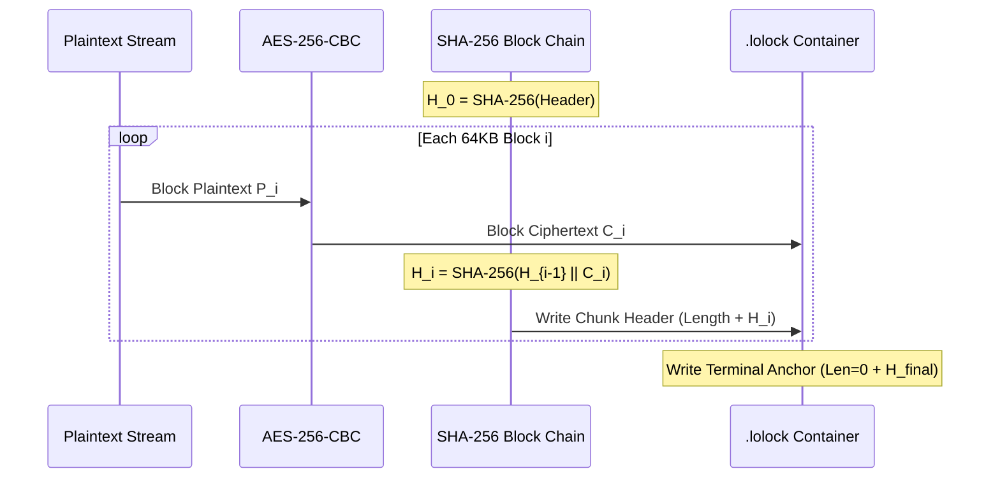

# Backend Cryptographic Engine: Argon2id + Blockchain CBC Fusion

## 1. Cryptographic Design Goals

The Keeper LoLock backend cryptographic engine is engineered to resist:
1. **GPU/ASIC Brute-Force & Dictionary Attacks**: Mitigated via memory-hard Argon2id key derivation.
2. **Ciphertext Tampering & Bit-Flipping**: Mitigated via block-level SHA-256 chained integrity hashing (blockchain model).
3. **Wrong Password Data Corruption**: Mitigated via instant HMAC-SHA256 verification tag checks before attempting decryption.
4. **Memory Exhaustion (OOM)**: Mitigated via constant 64KB chunked streaming pipelines.

---

## 2. Key Derivation Function (Argon2id)

Keeper LoLock utilizes **Argon2id** (version 13), the winner of the Password Hashing Competition (PHC), providing hybrid defense against both side-channel cache attacks and GPU-accelerated parallel cracking.

### Parameters
| Parameter | Value | Rationale |
| :--- | :--- | :--- |
| **Algorithm** | Argon2id | Hybrid data-dependent and data-independent memory access |
| **Version** | 0x13 (19) | RFC 9106 standardized version |
| **Memory Cost** | 16,384 KB (16 MB) | Heavy memory hardness to prohibit mass GPU parallelism while executing cleanly on mobile devices |
| **Time Cost** | 3 Iterations | Provides optimal balance between high security and responsive UI (<150ms on mobile CPUs) |
| **Parallelism** | 1 Thread | Predictable single-thread CPU consumption |
| **Salt Length** | 16 Bytes (128-bit) | Cryptographically secure random (`SecureRandom`) per container |
| **Key Output** | 64 Bytes (512-bit) | Split into 32-byte AES key and 32-byte HMAC key |

### Key Splitting Formula
$$\text{DerivedBytes}_{64} = \text{Argon2id}(P, S, m=16384, t=3, p=1)$$
$$K_{\text{enc}} = \text{DerivedBytes}[0 \dots 31] \quad (\text{256-bit AES Key})$$
$$K_{\text{hmac}} = \text{DerivedBytes}[32 \dots 63] \quad (\text{256-bit HMAC Key})$$

---

## 3. Blockchain CBC Fusion (Block-Chained Integrity)

The encryption cipher combines **AES-256-CBC** with a continuous **SHA-256 block-chaining** protocol:

### Mathematical Formulation

1. **Genesis Anchor ($H_0$)**:
   $$H_0 = \text{SHA-256}(\text{MAGIC} \parallel \text{VERSION} \parallel \text{SALT} \parallel \text{IV} \parallel \text{FILENAME} \parallel \text{MIME} \parallel \text{LENGTH})$$

2. **Block Recurrence Relation**:
   For each chunk $i \in \{1, \dots, N\}$:
   $$C_i = \text{AES-256-CBC}_{K_{\text{enc}}, \text{IV}}(P_i)$$
   $$H_i = \text{SHA-256}(H_{i-1} \parallel C_i)$$

3. **Tamper Proofing**:
   If an adversary alters even a single bit in chunk $k$:
   $$\widetilde{C}_k \neq C_k \implies \widetilde{H}_k = \text{SHA-256}(H_{k-1} \parallel \widetilde{C}_k) \neq H_k$$
   Because the expected hash $H_k$ stored in the block header fails `MessageDigest.isEqual()`, decryption immediately terminates with a `SecurityException`. Subsequent blocks cannot be forged without re-hashing the entire remainder of the chain.

---

## 4. Key Verification Tag

To avoid decrypting multi-gigabyte files when an incorrect password is typed:
$$\text{Tag}_{\text{verify}} = \text{HMAC-SHA256}(K_{\text{hmac}}, \text{SALT})$$
Before deciphering the stream, `verifyPassword()` re-computes the HMAC in constant time. If it fails, an authentication error is surfaced within milliseconds without consuming CPU cycles on file I/O.
